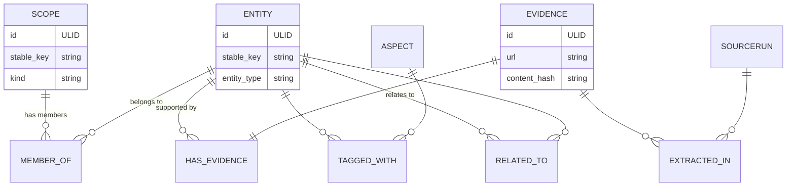

# Graph Ontology v1 — Core Data Model (Redesign Step 2)

**Top-Down Definition** — We are defining the ontology starting from the highest level, as requested.

This document is the concrete output of **Step 2: Core Ontology Definition** from the approved Graph Structure Redesign Plan.

## Top-Down Structure (Highest Level First)

We define the graph from the broadest organizational concepts down to the leaves.

### 0. The Graph Root (Implicit)

- There is one graph per research workspace / installation.
- The **root** has no explicit node. It is the set of all **Top-Level Scopes**.
- In the UI (L0 / Home):
  - Show one node/card per top-level Scope.
  - "All domains" in the old plan becomes "All top-level Scopes".
- Global operations (search across everything, unread summary) are against the entire graph.

### 1. Top-Level Scopes (the highest level — Industries)

These are the **root organizational units** of the graph (L0).

- **Kind**: `domain`
- They have **no parent Scope**.
- They represent the primary **Industries** being researched.

**Current top-level Industries** (as specified):

| stable_key            | Name                                      | Focus |
|-----------------------|-------------------------------------------|-------|
| `space-industry`      | Space Industry                            | Launch vehicles, satellites, exploration, reusability |
| `autonomous-ai`       | Autonomous AI Industry                    | Self-driving, robotics, physical agents |
| `ai-models-infra`     | AI Models and Infrastructure Industry     | Foundation models, chips, training clusters, inference |
| `crypto-industry`     | Crypto Industry                           | Blockchains, DeFi, NFTs, digital assets, and web3 markets |

**Fleshed out Crypto sub-domains added to match the style of other industries.**

**Key properties**:
- `stable_key`
- `name`
- `kind`: "domain"
- `description`
- `default_aspects`
- `color` / `icon` (for L0 visualization)
- `is_top_level`: true

Top-level Industries function as **facets / collections**. Knowledge attaches to them via `MEMBER_OF`, not by being descendants in a tree.

### 2. Sub-Scopes (lightweight hierarchy)

Each top-level Industry can have a tree of sub-scopes using `PARENT_OF` edges (kinds: `sub_domain`, `area`, `theme`).

The hierarchy is **lightweight** — only for navigation, breadcrumbs, default aspect inheritance, and scoping runs. Entities and evidence attach via `MEMBER_OF` / `EVIDENCE_FOR` (allowing overlap).

**Fleshed-out sub-areas per Industry** (matching `data/config/scopes.yaml`):

**Space Industry** (refined sub-area definition)

- **Launch Capabilities** (sub_domain)
  - Reusable Launch Vehicles (area) — Falcon-class boosters, first-stage recovery, rapid reuse
  - Heavy-Lift Launch Vehicles (area) — Starship, SLS-class next-gen super heavy
  - SmallSat & Rideshare Launch (area) — Dedicated small launchers and rideshare
  - Booster Reusability & Recovery (area) — Landing systems, recovery vessels, refurbishment

- **Satellite Systems & Constellations** (sub_domain)
  - Broadband LEO Constellations (area) — Starlink, OneWeb, Kuiper global connectivity
  - Earth Observation & Remote Sensing (area) — Optical, SAR, hyperspectral, ISR, climate
  - Navigation, Timing & Communications (area) — PNT and satcom
  - In-Orbit Servicing & Manufacturing (area) — Refueling, repair, assembly, ISRU, debris removal

- **Propulsion & Power** (sub_domain)
  - Chemical Propulsion (area)
  - Electric & Ion Propulsion (area)
  - Advanced & Nuclear Propulsion (area)

- **Space Hardened Hardware** (sub_domain)
  - Chips and Circuits (area) — Radiation-hardened processors, memory, FPGAs, and integrated circuits
  - Solar Panels (area) — Space-grade solar arrays and photovoltaic systems
  - Other Hardware (area) — Batteries, sensors, actuators, connectors, and other space-qualified components

- **Human Spaceflight & Exploration** (sub_domain)
  - Crewed Vehicles & Capsules (area)
  - Deep Space & Lunar/Mars Exploration (area)

- **Moon Based Activities** (sub_domain)
  - Moon Base (area) — Permanent habitats, bases, and lunar surface operations
  - Moon Mining (area) — In-situ resource utilization (ISRU), regolith mining, and lunar resources

- **Ground Segment & Operations** (area) — Launch sites, mission control, ground stations, SSA

This structure follows the original plan (Reusability as a key area under Launch) while adding investment-relevant depth in satellites, propulsion, human exploration, and in-orbit economy. All are lightweight Scopes for navigation/scoping; entities attach via MEMBER_OF.

**Autonomous AI Industry** (fleshed-out sub-domains)

This industry now has a comprehensive set of sub-domains covering the main application areas of autonomous systems.

- **Ground Autonomous Vehicles** (sub_domain)
  - Autonomous Passenger Vehicles (area) — Robotaxis, autonomous cars, personal mobility
  - Autonomous Trucking & Logistics (area) — Long-haul autonomous trucks and freight
  - Delivery & Last-Mile Robotics (area) — Sidewalk robots and urban logistics

- **Aerial Autonomy** (sub_domain)
  - Commercial Drones & Delivery UAVs (area)
  - eVTOL & Urban Air Mobility (area)
  - Defense, Surveillance & Inspection UAVs (area)

- **Maritime & Subsea Autonomy** (sub_domain)
  - Autonomous Surface Vessels (area)
  - Underwater Vehicles & ROVs (area)

- **Humanoids & Service Robotics** (sub_domain)
  - Humanoid Robots (area) — General-purpose humanoids for homes and work
  - Service & Companion Robots (area)

- **Industrial & Warehouse Automation** (sub_domain)
  - Warehouse & Logistics Robotics (area)
  - Factory & Manufacturing Automation (area)

- **Defense & Security Autonomy** (sub_domain)
  - Military & Tactical Robots (area)
  - Security & Surveillance Robots (area)

- **Autonomy Software & AI Stack** (sub_domain)
  - Perception & Sensing (area)
  - Planning, Control & Decision Making (area)
  - Simulation, Digital Twins & Testing (area)

**AI Models and Infrastructure Industry** (fleshed-out sub-domains)

- **Foundation Models** (sub_domain)
  - Large Language Models (area) — Text-focused frontier models
  - Vision, Video & Multimodal Models (area)
  - Reasoning Models & Agentic Systems (area)
  - Open-Source & Community Models (area)

- **Training Infrastructure** (sub_domain)
  - AI Chips & Accelerators (area)
  - GPU/TPU Clusters & Data Centers (area)
  - Power, Cooling & Energy Systems (area)
  - High-Speed Interconnects & Networking (area)

- **Inference & Edge Deployment** (sub_domain)
  - Cloud-Scale Inference (area)
  - Edge & On-Device Inference (area)
  - Quantization, Distillation & Optimization (area)

- **Data & Datasets** (sub_domain)
  - Web-Scale & Multimodal Datasets (area)
  - Synthetic Data Generation (area)
  - Data Labeling, Curation & Quality (area)

- **Model Development & Lifecycle** (sub_domain)
  - Training Frameworks & Tooling (area)
  - Fine-tuning, RLHF & Alignment (area)
  - Evaluation, Benchmarking & Red Teaming (area)

- **AI Safety, Security & Governance** (sub_domain)
  - Safety & Alignment Research (area)
  - Model Security & Adversarial Robustness (area)
  - Evaluation, Auditing & Policy Tools (area)

**Crypto Industry** (fleshed-out sub-domains)

- **Layer 1 Blockchains** (sub_domain)
  - Bitcoin (area)
  - Ethereum (area)
  - Solana (area)
  - Other Major L1s (area)

- **Layer 2 Scaling & Rollups** (sub_domain)
  - Optimistic Rollups (area)
  - ZK-Rollups & Validity Proofs (area)

- **DeFi (Decentralized Finance)** (sub_domain)
  - Lending & Borrowing Protocols (area)
  - DEXs & Automated Market Makers (area)
  - Derivatives & Perpetual Futures (area)

- **Stablecoins** (sub_domain)
  - Fiat-Collateralized Stablecoins (area)
  - Crypto-Collateralized Stablecoins (area)
  - Algorithmic & Hybrid Stablecoins (area)

- **Crypto-Based Payments** (sub_domain)
  - On-Chain Payments & Remittances (area)
  - Merchant Payments & Point-of-Sale (area)
  - Payment Protocols & Rails (area)

- **NFTs, Gaming & Digital Collectibles** (sub_domain)
  - Non-Fungible Tokens (area)
  - Blockchain Gaming & Metaverse (area)

- **Crypto Infrastructure & Tools** (sub_domain)
  - Oracles, Bridges & Cross-Chain (area)
  - Wallets, Custody & Key Management (area)

- **Network Security & Consensus** (sub_domain)
  - Proof-of-Work Mining (area)
  - Proof-of-Stake & Validation (area)

- **CeFi & Institutional Adoption** (sub_domain)
  - Centralized Exchanges (CEX) (area)
  - ETFs, Funds & Institutional Products (area)
  - Institutional & OTC Services (area)

- **Regulatory & Policy Developments** (sub_domain)
  - Policy & Regulatory Developments (area)

- **Security, Hacks & Risk Management** (sub_domain)
  - Exploits, Hacks & Smart Contract Risks (area)
  - Risk Management & Insurance (area)

This structure supports both deep drill-down within an industry and cross-industry faceting (e.g. an AI chip company relevant to both AI Models & Infra and Autonomous AI).

### 3. Scope as the Universal Attachment Point

From this level down, the most important concept is:

> **Any Scope can be a target for knowledge attachment.**

- Use `MEMBER_OF` to say "this Entity is relevant to this Scope".
- Use `EVIDENCE_FOR` for broad notes that apply to the whole Scope.
- Scopes become the primary unit for:
  - `?focus=space-industry/reusable-launch`
  - Running research / triggers
  - Unread rollups
  - Aspect filtering defaults

### 4. Discovering Developments (and associating to sub-domains, areas, and companies)

See the `discover_developments` helper in `backend/app/models/graph.py`.

It is now wired with real search via:
- `_perform_semantic_search(query)` – produces realistic results (replace with actual Grok/xAI search tool call in production)
- `_llm_extract_deltas(search_results, scope)` – turns search results into structured graph deltas (replace with real LLM structured output)

Usage:
```python
deltas = discover_developments(scope_node, use_real_search=True)
# deltas contains entities, evidence, edges ready for upsert
```

### 5. Discovering and Associating Companies (Entities)

To populate companies for an industry like Space Industry:

1. **Use the Scope tree**: All sub-domains and areas under "space-industry" are the targets.

2. **Discovery**:
   - Per sub-domain/area, run targeted semantic searches (Grok web search or equivalent):
     - Example for `reusable-launch`: "companies developing reusable orbital launch vehicles 2024 2025" or "SpaceX competitors reusability Blue Origin"
     - For `broadband-constellations`: "companies operating LEO satellite internet constellations Starlink competitors"
     - For `moon-base`: "companies developing lunar habitats bases NASA Artemis contractors"
     - For `chips-circuits`: "radiation hardened space grade processor chip companies"
   - General: "top space industry companies 2025" then map activities.
   - Sources: web, news, filings, X, company sites.

3. **Classification & Association**:
   - For each extracted company (normalize to stable_key e.g. "spacex", "blue-origin"):
     - Create/update Entity node with `entity_type: "company"`, summary, etc.
     - Use LLM + scope descriptions to decide which scopes it belongs to (a company can match multiple, e.g. SpaceX touches launch, satellites, moon, hardware indirectly).
   - Create `MEMBER_OF` edges (one per relevant scope) with metadata: `priority`, `discovered_via`, `query_used`.

4. **Implementation**:
   - In code (see `backend/app/models/graph.py` example_graph for seeded examples).
   - Add a `discover_companies(scope_slug: str, query: str)` helper that:
     - Runs search.
     - Extracts candidates.
     - Classifies.
     - Upserts Entity + edges.
   - Run per aspect or per sub-domain, then merge duplicates via entity resolution (stable_key + fuzzy match).
   - Aspect tag: link to "companies" aspect.

5. **Seeded examples** (in current prototype):
   - SpaceX: linked to launch-capabilities (reusable, heavy, reusability), satellite-systems (broadband), moon-based-activities, etc.
   - Blue Origin, Rocket Lab, Relativity Space, Firefly, Planet Labs, Sierra Space, Northrop Grumman, Lockheed Martin, Boeing, Astrobotic: mapped to relevant launch/satellite/moon/hardware scopes.
   - Hardware specialists (BAE Systems for chips-circuits, Spectrolab for solar-panels).

This process can be repeated/automated for freshness using the research cycle triggers. Unread state will update on new associations.

See also LLM extraction output shape in section 8 for structured deltas.

---

## 1. Node Types (continuing the definition)

All nodes share a common base. Specific types add or require fields inside `properties` or as top-level for indexing.

### Base Node

```python
# Pseudocode / Pydantic sketch
class GraphNode:
    id: str                    # ULID or UUIDv7 (stable, sortable)
    type: str                  # "scope" | "entity" | "evidence" | "aspect" | "source_run"
    stable_key: str | None     # e.g. "spacex", "booster-reuse-2026"
    properties: dict           # arbitrary but documented per type
    last_updated_at: datetime
    created_at: datetime
    source_run_ids: list[str] = []  # provenance
```

### 1.1 Scope (the central organizational node — defined top-down)

Scopes are first-class nodes and the highest-level concept in the ontology.

**Distinguished roles** (via `kind` and position in the optional hierarchy):

| Kind        | Typical Level      | Description                                      | Can be top-level? |
|-------------|--------------------|--------------------------------------------------|-------------------|
| `domain`    | Top                | Major partition (e.g. Equities, Thematic)        | Yes               |
| `sub_domain`| Second             | Grouping inside a domain                         | Rarely            |
| `area`      | Third+             | Focused research area (old "Area of Interest")   | Sometimes         |
| `theme`     | Any                | Cross-cutting theme (can attach to many domains) | Yes               |
| `custom`    | Any                | User-created ad-hoc collection                   | Yes               |

**Core fields / properties for every Scope**:
- `stable_key` (required, unique within type)
- `name`
- `kind`
- `description`
- `parent_id` (optional — used only for the lightweight Scope tree)
- `default_aspects`: list[str]
- `config_source`: where this Scope was originally declared (for sync)
- `color`, `icon` (optional UI metadata)

**Derived / computed**:
- `is_top_level`: true when there is no `parent_id` / no incoming `PARENT_OF` edge.
- `path`: materialized string like `space-industry/reusable-launch` (only when part of a tree; used for focus URLs and breadcrumbs).

**Fundamental relationship from lower levels**:
- Entities attach via `MEMBER_OF` edge (many-to-many).
- This is how faceting and overlapping work.

**Creation**:
- Initially from config (`data/config/scopes.yaml`).
- Later: users can create ad-hoc Scopes directly in the UI (these are `kind: custom` or promoted).

### 1.2 Entity

Core knowledge objects.

**Required in properties**:
- `name`
- `entity_type`: "company" | "capability" | "technology" | "product" | "person" | "event" | "metric" | ... (aligns with aspects registry `entity_types`)

**Common**:
- `summary`
- `aliases`: list[str]
- `urls`, `tickers`, `founded`, etc. (free form in properties)
- `confidence`: 0.0–1.0 (from extraction)

### 1.3 Evidence

A concrete sourced observation, quote, data point, or document.

**Key properties**:
- `title` / `headline`
- `snippet` or `content` (excerpt)
- `url`
- `published_at`
- `fetched_at`
- `content_hash`: for deduping
- `confidence`
- `raw_ref`: pointer into source payload

Evidence can exist with or without direct entity links (e.g. broad market notes attached at Scope level).

### 1.4 Aspect (lightweight)

Can be promoted to full nodes or stay as a registry reference.

For graph: we store `Aspect` nodes (or just use the registry slugs).

Properties mirror `config/aspects.yaml`:
- `slug`, `name`, `entity_types`, `builtin`

### 1.5 SourceRun

Provenance anchor (from the sources redesign).

- `source_type`: "grok_semantic" | "rss_atom" | "x_api" | ...
- `trigger`: {scope: "...", aspect: "capabilities", query: "..."}
- `fetched_at`, `item_count`, `status`
- Links via `EXTRACTED_IN` to Evidence it produced.

---

## 2. Edge / Relationship Types

All edges have:
- `source_id`, `target_id`
- `type`
- `properties`: { relation_type?, confidence?, added_at?, ... }

### Primary Edges

| Edge Type         | From          | To             | Meaning / Properties                          | Cardinality     |
|-------------------|---------------|----------------|-----------------------------------------------|-----------------|
| `MEMBER_OF`       | Entity        | Scope          | Entity belongs to this research scope/area. `priority`, `discovered_via` | many-to-many   |
| `TAGGED_WITH`     | Entity/Evidence | Aspect      | Aspect classification. `confidence`, `method` | many-to-many   |
| `HAS_EVIDENCE`    | Evidence      | Entity         | This evidence supports / is about the entity. `strength` | 1..N           |
| `EVIDENCE_FOR`    | Evidence      | Scope          | Evidence relevant to entire scope (broad context) | optional       |
| `RELATED_TO`      | Entity        | Entity         | `relation_type`: "competitor" \| "supplier" \| "acquired" \| "same_as" \| "enables" \| "cites" \| "depends_on" \| custom | many-to-many |
| `EXTRACTED_IN`    | Evidence / Entity | SourceRun   | Produced by this source execution             | many           |
| `MENTIONS`        | Evidence      | Entity         | Lighter co-occurrence (not full HAS_EVIDENCE) | many           |
| `CONTAINS` / `PARENT_OF` | Scope | Scope     | Optional scope hierarchy (for breadcrumb tree) | tree (optional) |

Notes:
- Prefer explicit edges over baking everything into `properties`.
- `same_as` edges or a merge process for canonical entities.
- Edges can carry `extracted_from_evidence_id` for traceability.

---

## 3. ID & Key Rules

- **id**: ULID (preferred) or UUIDv7. Never reassign. Used in edges and DB.
- **stable_key**: 
  - Generated as lower-kebab or domain-specific (e.g. ticker + name for companies).
  - Must be unique **within type** (or globally with type prefix).
  - Used for LLM output, config references, and matching on upsert.
- **Scope path** (derived): materialized from `PARENT_OF` chain + slug when a hierarchy exists. Used for `?focus=...` and human URLs.
- Read state keys: prefer `(type, stable_key)` or `(type, scope_path)` combinations. More resilient than old full path IDs.

Example IDs:
- Scope: `id=01H...`, `stable_key=reusability`, path=`space-industry/launch-capabilities/reusability`
- Entity: `id=01H...`, `stable_key=spacex`
- Evidence: `id=01H...`, `stable_key` optional or hash-derived

---

## 4. Aspect Integration

- Registry lives in `config/aspects.yaml` (authoritative names, entity_types).
- Graph uses `TAGGED_WITH` edges (or denormalized `aspects: ["capabilities", ...]` array on nodes for fast filtering).
- At L3-style views: group/filter Entities by their current tags (React Flow groups or separate layout passes).
- Per-scope aspect enablement stays in config (or as properties on Scope + overrides).

---

## 5. Example Graph Fragment (JSON)

```json
{
  "nodes": [
    {
      "id": "01K8Q...A1",
      "type": "scope",
      "stable_key": "reusability",
      "properties": { "name": "Booster Reusability", "kind": "area" }
    },
    {
      "id": "01K8Q...E7",
      "type": "entity",
      "stable_key": "spacex",
      "properties": {
        "name": "SpaceX",
        "entity_type": "company",
        "summary": "Private space launch company...",
        "ticker": null
      }
    },
    {
      "id": "01K8Q...V9",
      "type": "evidence",
      "stable_key": null,
      "properties": {
        "title": "Falcon 9 landing success rate 2026",
        "url": "https://...",
        "snippet": "SpaceX achieved 142 successful landings...",
        "fetched_at": "2026-06-25T..."
      }
    }
  ],
  "edges": [
    {
      "source_id": "01K8Q...E7",
      "target_id": "01K8Q...A1",
      "type": "MEMBER_OF",
      "properties": { "priority": "high", "discovered_via": "grok_semantic" }
    },
    {
      "source_id": "01K8Q...V9",
      "target_id": "01K8Q...E7",
      "type": "HAS_EVIDENCE",
      "properties": { "strength": 0.92 }
    },
    {
      "source_id": "01K8Q...E7",
      "target_id": "aspect:capabilities",
      "type": "TAGGED_WITH",
      "properties": { "confidence": 0.95 }
    }
  ]
}
```

---

## 6. Mermaid ER Diagram (simplified)



---

## 7. Config Mapping — Top-Down

We now declare organization starting from the top.

Example: `data/config/scopes.yaml` (current highest level)

```yaml
top_level_scopes:
  - stable_key: space-industry
    name: "Space Industry"
    kind: domain
    children:
      - stable_key: reusability
        name: "Booster Reusability"
        kind: area
  - stable_key: autonomous-ai
    name: "Autonomous AI Industry"
    kind: domain
  - stable_key: ai-models-infra
    name: "AI Models and Infrastructure Industry"
    kind: domain
    children:
      - stable_key: training-infra
        name: "Training Infrastructure"
        kind: area
```

At startup / sync:
1. Create `ScopeNode` for every declared top-level Industry (`kind: domain`).
2. Create `PARENT_OF` edges for children.
3. Do **not** create Entities here.
4. Entities get attached later via `MEMBER_OF`.

This matches the top-down philosophy: first define the organizational skeleton (Scopes), then attach knowledge flexibly.

---

## 8. LLM Extraction Output Shape (target for later steps)

The graph upsert layer will accept deltas like:

```json
{
  "entities": [{"stable_key": "spacex", "properties": {...}, "tags": ["capabilities"]}],
  "evidence": [{"url": "...", "snippet": "...", "links_to": ["spacex"], "scopes": ["reusability"]}],
  "relations": [{"from": "spacex", "to": "rocketlab", "type": "competitor"}]
}
```

Resolution + edge creation happens in the store layer.

---

## 9. Open Decisions for Step 2 Review (Top-Down Focus)

- Should we support multiple *independent* top-level taxonomies (e.g. a completely separate "Filing Research" tree)?
- Do we want a special "Root Scope" node, or continue with implicit root = set of top-level Scopes?
- How aggressively should we enforce that only `domain` kinds can be top-level?
- For the InvestmentResearch use case, what are the actual top 3–5 top-level Scopes the user wants to start with?
- Inheritance rules: do child Scopes inherit `default_aspects` from parents, or only use their own?

**Next**: After review, move to Step 3 (ID/addressing details) + Step 4 (persistence choice + first CRUD implementation).

This ontology enables the flexible multi-area support requested while keeping the Command Center experience.