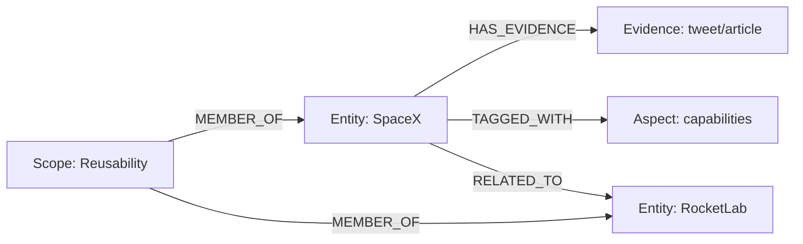
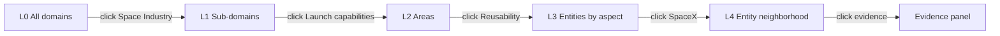

# Research Platform — Architecture Plan (v7)

> General-purpose research system: configurable domains, Grok semantic web search, personal source extraction, graph knowledge base, and a **graph-first Command Center** with drill-down navigation, read/unread coloring, and configurable themes.

## Locked-in decisions

| Area | Decision |
|------|----------|
| Build approach | **Greenfield rebuild** (no salvage of prior codebase) |
| Hierarchy | Domain → Sub-domain → Area of interest → Entity → Evidence |
| Default aspects | `companies`, `capabilities`, `technology`, `products`, `events` |
| Aspect config | Built-in registry + **add/update custom aspects** per area |
| Discovery | Grok semantic web search (per aspect queries) |
| Personal sources | X, Gmail, Substack (+ extensible) |
| Cadence | Cron + triggers + manual (inherit per level) |
| KB | Graph — entities, relationships, evidence |
| UI | **Graph drill-down** from Domain through all sub-levels |
| Node density | **Moderate** — balanced readability and context |
| Read state | **Green** = read, **Red** = unread (nodes and rollup rings) |
| Themes | **Configurable** visual theme setup (colors, density, typography) |
| Stack | FastAPI + Next.js + React Flow |

---

## 1. Hierarchy & Graph Structure (Redesigned)

**Note (v7+ redesign)**: The original strict 5-level path-based containment (Domain → Sub-domain → Area → Entity → Evidence) has been evolved for flexibility.

**New model direction**: 
- **Scopes** (organizational containers: Domain / Sub-domain / Area or general "Research Scopes") provide the primary navigation structure and work scoping.
- Knowledge lives in a **labeled property graph**: `Scope`, `Entity`, `Evidence`, `Aspect`, `SourceRun` nodes + explicit typed edges (`MEMBER_OF`, `TAGGED_WITH`, `HAS_EVIDENCE`, `RELATED_TO`, `EXTRACTED_IN`, ...).
- Entities and Evidence support **multi-membership** (one entity can belong to many scopes/areas via edges) and faceted organization.
- Navigation (L0–L5 drill-down, focus, breadcrumbs) is preserved via **view projections** from the graph for a given focus scope. The underlying model is no longer a rigid tree.
- Global addressing uses stable internal IDs + human stable keys + derived scope paths for focus/URLs.

See the approved "Graph Structure Redesign Plan" and `docs/graph-ontology.md` (to be populated in Step 2) for the full ontology, ID scheme, and edge types.

Legacy path ID example (for reference only): `{domain}/{sub_domain}/{area}/{entity_id}`

High-level mermaid (illustrative — actual structure uses edges):



---

## 2. Configurable aspects

### Platform aspect registry (`config/aspects.yaml`)

Built-in aspects ship with defaults; users can **add**, **update**, or **disable** aspects globally and override per area.

```yaml
# Built-in (editable — update name, entity_types, default_priority)
aspects:
  - slug: companies
    name: "Companies & organizations"
    entity_types: [company, agency]
    default_enabled: true
    builtin: true

  - slug: capabilities
    name: "Capabilities & performance"
    entity_types: [capability]
    default_enabled: true
    builtin: true

  - slug: technology
    name: "Technology developments"
    entity_types: [technology]
    default_enabled: true
    builtin: true

  - slug: products
    name: "Products & systems"
    entity_types: [product, system]
    default_enabled: true
    builtin: true

  - slug: events
    name: "Events & milestones"
    entity_types: [event]
    default_enabled: true
    builtin: true

  # Extended (default off)
  - slug: people
    name: "People & leadership"
    entity_types: [person]
    default_enabled: false
    builtin: true

  - slug: market
    name: "Market & economics"
    entity_types: [metric, deal]
    default_enabled: false
    builtin: true

  # Custom (user-added)
  - slug: ground-segment
    name: "Ground segment infrastructure"
    entity_types: [facility, system]
    default_enabled: false
    builtin: false
```

### Per-area overrides (`config/domains/*.yaml`)

```yaml
areas_of_interest:
  - slug: reusability
    name: "Booster reusability"
    aspects:
      # Reference registry slug; override enabled/priority only
      - slug: companies
        enabled: true
        priority: high
      - slug: capabilities
        enabled: true
        priority: high
      # Add area-specific custom aspect
      - slug: landing-infrastructure
        name: "Landing infrastructure"
        entity_types: [facility, technology]
        enabled: true
        priority: medium
        builtin: false
    search_queries:
      - aspect: capabilities
        query: "booster reuse landing rate 2026"
```

### Aspect CRUD rules

| Action | Where | Notes |
|--------|-------|-------|
| Enable/disable built-in | Per area or globally | Toggle only |
| Update built-in label/types | `config/aspects.yaml` | UI settings page mirrors this |
| Add custom aspect | Global registry or per-area | Must have unique slug |
| Delete custom aspect | Registry | Soft-delete; existing graph nodes keep tag |

**New area default:** auto-enable `companies`, `capabilities`, `technology`, `products`, `events` from registry.

---

## 3. Graph-first UI — drill-down navigation

The **primary interface is one interactive graph** that zooms/expands as you click deeper. No separate page-per-level required (detail panel supplements the graph).

### Graph levels (semantic zoom) — now view projections

The L0–L5 experience continues but is produced by **graph view projections** for a focus Scope (not rigid containment traversal).

| Level | Root view                  | Nodes shown (projected)                  | Click behavior |
|-------|----------------------------|------------------------------------------|----------------|
| **L0 — Home** | All top-level Scopes      | Scope nodes (domains)                    | Focus a Scope → L1 |
| **L1 — Domain** | Inside a Scope            | Child Scopes + directly attached Entities | Expand → L2 |
| **L2 — Sub-scope** | ...                     | More granular Scopes or entity groups    | → L3 |
| **L3 — Scope (Area)** | Focused scope         | Entities (grouped/filtered by aspect) + prominent Evidence | Expand entity → L4 |
| **L4 — Entity** | Neighborhood query (1-2 hops) | Related Entities + Evidence nodes     | Click evidence → side panel |
| **L5 — Evidence** | Side panel               | Full provenance, links, snippet          | Open source |



### Visual design

- **Breadcrumb** above graph: `All domains > Space Industry > Launch capabilities > Reusability`
- **Back / zoom out** — breadcrumb click or pinch-out restores parent level
- **Node shapes by level:**
  - Domain — large rounded rectangle
  - Sub-domain — medium hexagon
  - Area — circle
  - Aspect cluster — dashed grouping box
  - Entity — icon by type (company, event, …)
  - Evidence — small document node
- **Side panel** (right 35%) — metadata, run button, evidence detail, aspect filter
- **Minimap** — bottom-left, shows position in hierarchy

### Graph layout density (moderate)

| Parameter | Moderate default | Notes |
|-----------|------------------|-------|
| Max nodes per viewport | ~25–40 visible | Paginate/cluster beyond that |
| Node spacing (force layout) | `linkDistance: 120`, `charge: -400` | Tuned per theme |
| Entity labels | Truncate at 28 chars + tooltip | Avoid overlap |
| Edge opacity | 0.5 default, 1.0 on hover | Reduces visual noise |
| Clustering | Auto-group evidence under entity | Keeps L3–L4 readable |
| Expand animation | 300ms ease-out | Smooth drill-down |

Density is a **theme setting** — presets: `compact`, `moderate` (default), `spacious`.

### Aspect filtering within L3+

Toolbar chips filter visible entity nodes by aspect: `[All] [Companies] [Capabilities] …`  
Filtering dims non-matching nodes rather than removing them (preserves graph context).

---

## 4. Unread updates on graph nodes

Any node with **new evidence or graph changes since last visit** shows an unread indicator.

### Read-state model

```yaml
# data/read_state.json (or SQLite table)
nodes:
  "space-industry":
    last_read_at: "2026-06-20T10:00:00Z"
  "space-industry/launch-capabilities/reusability":
    last_read_at: "2026-06-21T08:00:00Z"
  "space-industry/launch-capabilities/reusability/entity:spacex":
    last_read_at: "2026-06-21T12:00:00Z"
```

Each graph node stores:
- `last_updated_at` — latest evidence or extraction timestamp
- `unread_count` — evidence items since user's `last_read_at` (computed)

**Unread condition:** `last_updated_at > last_read_at` (or `unread_count > 0`)

### Visual indicators (read / unread)

| Signal | Style |
|--------|-------|
| **Unread** | **Red** border/ring (`theme.colors.unread`) + red badge count |
| **Read** | **Green** border/ring (`theme.colors.read`) — calm, no badge |
| Unread count > 9 | Badge shows `9+` |
| New since last run | One-time subtle pulse on unread nodes |
| Parent with unread children | **Red dotted outer ring** (rollup); green when all children read |
| Mixed (some children unread) | Parent ring gradient red→neutral |

Read state drives **node stroke color** first; fill color stays theme-neutral for legibility.

### Mark-as-read behavior

- **Click node to drill down** → mark that node read when expanded
- **"Mark all read"** button per level (domain / sub-domain / area)
- **Visit evidence panel** → mark linked entity + evidence read
- Overview stat: `23 unread across 3 domains`

### Backend

```
GET  /api/graph?level=domain&focus=space-industry   # nodes + unread flags
POST /api/nodes/{id}/mark-read
GET  /api/unread/summary                            # counts per domain
```

---

## 4b. Configurable visual themes

Themes live in `config/themes.yaml` and are editable via **Settings → Appearance** in the UI.

```yaml
active_theme: default

themes:
  default:
    name: "Default"
    mode: dark                    # dark | light
    density: moderate             # compact | moderate | spacious
    colors:
      read: "#22c55e"             # green
      unread: "#ef4444"           # red
      read_muted: "#16a34a"
      unread_muted: "#dc2626"
      node_fill: "#1e293b"
      node_stroke_read: "#22c55e"
      node_stroke_unread: "#ef4444"
      edge: "#475569"
      background: "#0f172a"
      panel: "#1e293b"
    graph:
      link_distance: 120
      charge_strength: -400
      node_size_domain: 56
      node_size_sub_domain: 44
      node_size_area: 36
      node_size_entity: 32
      font_size: 13
    typography:
      font_family: "Inter, system-ui, sans-serif"

  light_classic:
    name: "Light Classic"
    mode: light
    density: moderate
    colors:
      read: "#15803d"
      unread: "#b91c1c"
      node_fill: "#f8fafc"
      background: "#ffffff"
      panel: "#f1f5f9"
    # ... graph + typography overrides

  high_contrast:
    name: "High Contrast"
    mode: dark
    density: compact
    colors:
      read: "#4ade80"
      unread: "#f87171"
```

### Theme API

```
GET  /api/themes                    # list themes
GET  /api/themes/active             # current theme
PUT  /api/themes/active             # switch theme
POST /api/themes                    # create custom theme (clone + edit)
PUT  /api/themes/{id}               # update colors, density, graph params
```

### Frontend integration

- CSS variables injected from active theme (`--color-read`, `--color-unread`, `--graph-link-distance`)
- React Flow node components read `node.data.read_state` → apply green/red stroke
- User preference persisted to `data/user_preferences.json`
- Live preview in Settings before save

---

## 5. Source layer

| Source | Method |
|--------|--------|
| Grok search | Per-area, per-aspect `search_queries` |
| X | OAuth — bookmarks + lists |
| Gmail | OAuth — nested labels |
| Substack | RSS/Atom feeds |

Personal items → classify to area + aspect → graph upsert → update `last_updated_at` → nodes become unread.

---

## 6. Knowledge graph (Redesigned — see Graph Redesign Plan)

The graph is a **labeled property graph** with explicit nodes and typed edges. This replaces the previous uniform "level" + path-ID model.

Core node types:
- **Scope**: Organizational (was Domain/Sub/Area). Supports optional hierarchy + many-to-many membership.
- **Entity**: Primary knowledge objects (companies, technologies, events, etc.).
- **Evidence**: Sourced items with provenance.
- **Aspect**, **SourceRun**, etc.

Edges (examples): `MEMBER_OF` (flexible scope attachment), `TAGGED_WITH`, `HAS_EVIDENCE`, `RELATED_TO` (with `relation_type`), `EXTRACTED_IN`.

### Key fields (common + type-specific)

| Field              | Purpose |
|--------------------|---------|
| `id`               | Stable internal ID (UUID/ULID) |
| `type`             | scope \| entity \| evidence \| aspect \| source_run |
| `stable_key`       | Human-readable, stable key for resolution (e.g. `spacex`) |
| `properties`       | Flexible JSON metadata (name, summary, url, ticker, etc.) |
| `last_updated_at`  | Drives unread + freshness |

See the redesign plan (Step 2 ontology) and upcoming `docs/graph-ontology.md` for complete field lists, edge types, and examples.

### Entity resolution & membership

- Stable keys + fuzzy matching during upsert.
- Multi-membership via `MEMBER_OF` edges (solves overlapping areas).
- `SAME_AS` or merge logic for canonicalization.
- Evidence and entities can attach to multiple scopes and aspects.

Previous `BelongsToArea` is generalized to membership edges.

---

## 7. Research cycle

1. Trigger (cron / event / manual) at domain, sub-domain, area, or aspect scope
2. Grok search per enabled aspect queries
3. Personal source ingest + classify
4. LLM graph extraction (aspect-tagged)
5. Upsert graph; bump `last_updated_at` on affected nodes
6. Optional synthesis report per area
7. Unread counts propagate up to parent nodes (rollup)

---

## 8. API + routes

```
GET  /api/graph                          # L0 domains
GET  /api/graph?focus={domain}           # L1
GET  /api/graph?focus={domain}/{sub}     # L2
GET  /api/graph?focus={domain}/{sub}/{area}  # L3+
POST /api/domains/{d}/{sub}/{area}/run
GET  /api/aspects                        # registry
PUT  /api/aspects/{slug}                 # update aspect
POST /api/aspects                        # add custom aspect
```

**Frontend:** single page `/` with React Flow canvas; URL reflects focus: `/?focus=space-industry/launch-capabilities/reusability`

---

## 9. Phased delivery

| Phase | Deliverable |
|-------|-------------|
| 0 | Greenfield scaffold: FastAPI + Next.js; `config/aspects.yaml`, `config/themes.yaml`, domain schema; React Flow L0–L2 with theme + read/red states |
| 1 | Aspect registry CRUD (API + settings UI) |
| 2 | Theme editor UI + density presets; Grok search stub |
| 3 | Grok search + extraction; L3 entity nodes |
| 4 | Personal ingestors; unread state + red/green indicators |
| 5 | L4 entity neighborhood + evidence panel |
| 6 | Cadence engine (cron + triggers) |
| 7 | Review queue + self-critique + polish (minimap, keyboard nav) |

---

## 10. Resolved / open

| Item | Status |
|------|--------|
| Default aspects | **Confirmed** — 5 defaults |
| Custom aspects | **Confirmed** — add/update via registry + per-area |
| UI paradigm | **Confirmed** — graph drill-down L0→L5 |
| Read / unread colors | **Confirmed** — green = read, red = unread |
| Node density | **Confirmed** — moderate (configurable per theme) |
| Visual themes | **Confirmed** — `config/themes.yaml` + Settings UI |
| Build approach | **Confirmed** — greenfield rebuild |
| Substack via Gmail vs RSS | **Open** |

## Todos

- [x] Greenfield rebuild
- [x] UI: moderate density, red unread, green read, configurable themes
- [ ] Approve v7 plan for implementation
- [ ] Begin Phase 0 (greenfield scaffold)